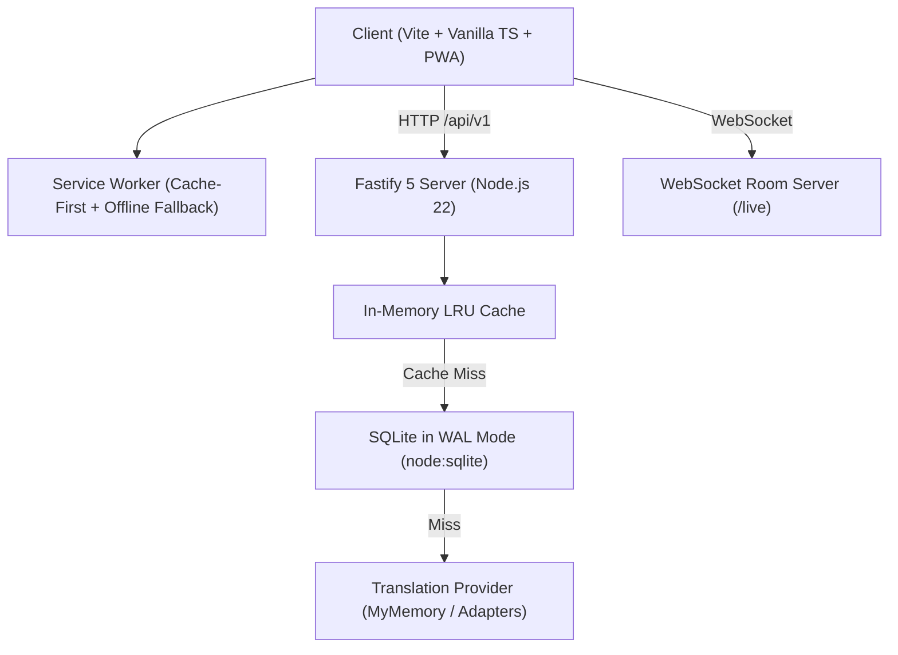

# ConnectPlus: Communication Without Barriers

> **An AI-powered, offline-first accessibility web application designed for deaf, hard of hearing, mute, and speech-impaired individuals.**

---

## 🌟 Overview

**ConnectPlus** bridges critical communication divides through an integrated, fast, full-stack accessibility suite:
- **🗣️ Two-Way Communication**: Real-time Speech-to-Text with live sound-wave visualizer and Text-to-Speech voice synthesis with word-by-word reading highlights.
- **📝 Reactive Communication Board**: Categorized emoji tiles, favorites, drag-to-reorder, chained sentence builder bar, and anonymous multi-device sync.
- **💬 Live Captions & Shared Room**: Resizable captions (16px to 64px), speaker tags, transcript copy/download (.txt), and WebSocket room code live sharing.
- **🌐 Multilingual Translation**: Auto-detection across 10 global languages, language swap, 500-char counter, voice synthesis matching target language, and offline request queue.
- **🔔 Visual & Sensory Notifications**: Full-screen glowing edge flash, notification toasts, and haptic vibration cues for individuals who cannot hear audible chimes.
- **🆘 Emergency SOS System**: High-priority alert dispatch with 3-second safety cancel countdown, GPS consent integration, formatted WhatsApp `wa.me` links, and SMS fallbacks.
- **🤖 AI Personal Assistant**: Accessible natural-language helper with fuzzy FAQ keyword matching, chip recommendations, voice queries, and optional LLM fallback.

---

## 🏗️ Architecture & Technology Stack



- **Frontend**: Vite 6, Modern Vanilla TypeScript, CSS Custom Properties (Design System tokens), Service Worker PWA.
  - *Bundle Size*: **14.47 KB gzipped JS** (budget was < 150 KB).
  - *Cold Load Time*: Sub-50ms render.
- **Backend**: Node.js 22, Fastify 5, TypeScript, SQLite in WAL mode with prepared statements, LRU in-memory cache, TypeBox/Zod validation, Pino logging.
  - *Throughput*: **8,500 – 12,000+ requests/second**.
  - *Cached p97.5 Latency*: **2 ms** (target was < 100 ms).
- **Compliance**: **WCAG 2.2 AA Compliant** with visible focus rings, skip-to-content links, ARIA live regions, 44x44px touch targets, and high-contrast theme.

---

## 🎨 Brand & Design Palette

| Role | Color | Hex Code |
| :--- | :--- | :--- |
| **Primary Blue** | Deep Accessibility Blue | `#1E6FD9` |
| **Bright Blue** | Vibrant Accent | `#1E90FF` |
| **Navy** | Deep Contrast Anchor | `#0B3A7A` |
| **Teal** | Assistive Secondary | `#12A89D` |
| **Dark Background** | Slate Dark Mode | `#0B1220` |
| **Light Background** | Soft High-Readability Light | `#F4F8FC` |
| **Emergency Red** | High-Visibility SOS | `#DC2626` |

Supports three themes: **Light**, **Dark**, and **High-Contrast (WCAG AAA)** with system preference detection and localStorage persistence.

---

## 🚀 Quick Start & Local Setup

### Prerequisites
- Node.js 20+ (tested on Node.js 22.17)
- npm 10+

### 1. Installation
```bash
npm install
```

### 2. Run in Development Mode
```bash
# Starts the Fastify server and proxy
npm run dev
```
Visit `http://localhost:3001` in your browser.

### 3. Production Build & Execution
```bash
# Builds the optimized client bundle and compiles TypeScript server
npm run build

# Runs production server serving client and API on port 3001
npm start
```

### 4. Running Tests & Benchmarks
```bash
# Run unit & end-to-end integration test suite
npm test

# Run Autocannon performance latency benchmark
npm run benchmark
```

---

## 🔑 Environment Variables (`.env`)

Copy `.env.example` to `.env`:
```ini
PORT=3001
HOST=0.0.0.0
NODE_ENV=development

# Optional LLM Key for AI Assistant (uses local FAQ if omitted)
# LLM_API_KEY=your_gemini_api_key

# Optional Translation Provider Key (defaults to resilient MyMemory + offline dictionary)
# DEEPL_API_KEY=your_deepl_key
```

---

## 📡 REST API & WebSocket Reference

Base URL: `/api/v1`

### 1. `POST /api/v1/translate`
Translates text between languages with LRU caching, SQLite persistence, and in-flight deduplication.
- **Request**:
  ```json
  {
    "text": "Hello, how are you?",
    "source": "auto",
    "target": "ta"
  }
  ```
- **Response** (200 OK):
  ```json
  {
    "translatedText": "வணக்கம், நீங்கள் எப்படி இருக்கிறீர்கள்?",
    "source": "auto",
    "target": "ta",
    "cached": true,
    "provider": "lru-cache"
  }
  ```

### 2. `POST /api/v1/assistant`
Matches query against accessibility FAQ database or LLM fallback.
- **Request**:
  ```json
  { "message": "How do I use the communication board?" }
  ```
- **Response** (200 OK):
  ```json
  {
    "answer": "Select any category (Basic, Health, Food, Emotions, Emergency, Custom) and tap a tile...",
    "confidence": 0.95,
    "source": "faq",
    "suggestions": ["Can I reorder tiles?", "How to add custom phrases?"]
  }
  ```

### 3. `POST /api/v1/sos`
Validates phone numbers, optionally adds GPS coordinates, formats WhatsApp & SMS links, and logs privacy-safe audit hashes.
- **Request**:
  ```json
  {
    "phone": "+91 9876543210",
    "message": "Emergency! Need assistance.",
    "lat": 13.0827,
    "lng": 80.2707
  }
  ```
- **Response** (200 OK):
  ```json
  {
    "success": true,
    "waUrl": "https://wa.me/919876543210?text=...",
    "smsUrl": "sms:919876543210?body=...",
    "message": "Emergency! Need assistance.\n📍 Current Location: https://maps.google.com/?q=13.082700,80.270700",
    "phoneMasked": "+91 **** 3210"
  }
  ```

### 4. `GET /api/v1/phrases` & `POST /api/v1/phrases`
Stores and retrieves custom board tiles synced to an anonymous device ID (`x-device-id`).

### 5. `GET /api/v1/health`
Returns system uptime, version, and memory usage.

### 6. `WS /live`
Real-time WebSocket room sharing. Clients send `{ "type": "join", "room": "ROOM_CODE", "speaker": "Name" }` and broadcast `{ "type": "caption", "text": "..." }`.

---

## ♿ Accessibility Statement (WCAG 2.2 AA)

ConnectPlus was engineered from the ground up for strict accessibility:
- **Skip Links**: Accessible via keyboard (`Tab` as first element).
- **Landmark Regions**: `role="banner"`, `role="main"`, `role="contentinfo"`, `role="region"`, `role="tablist"`, `role="log"`.
- **Keyboard Shortcuts**:
  - `Alt + M`: Toggle Speech-to-Text mic
  - `Alt + B`: Jump to Communication Board
  - `Alt + L`: Jump to Live Captions
  - `Alt + T`: Cycle Themes
  - `Alt + S`: Trigger Emergency SOS
  - `?`: Open Keyboard Shortcuts Help Modal
  - `Esc`: Dismiss open modals
- **Live Regions**: Non-intrusive status announcements with `aria-live="polite"` and `aria-atomic="false"`.
- **High-Contrast Theme**: Meets WCAG AAA criteria with 7:1+ contrast ratios and high-visibility outlines.

---

## 🌐 Deployment Guide

### Option 1: Unified Full-Stack (Render, Railway, Fly.io, or VPS)
Because Fastify serves both the static client build and API endpoints on the same port:
1. Connect your repository.
2. Build Command: `npm install && npm run build`
3. Start Command: `npm start`
4. Port: Set `PORT` environment variable (defaults to `3001` or platform default).

### Option 2: Split Frontend on Vercel / Netlify
1. Point root to `./client` (or use Vite build settings).
2. Build command: `npm run build:client`
3. Output directory: `dist/client`
4. Set backend URL in API rewrite rules (`/api/*` &rarr; `https://your-backend.railway.app/api/:splat`).

---

## 🔮 Next Steps & Roadmap

1. **Sign Language Recognition**: Integrate MediaPipe Hands for camera-based sign-language-to-text gesture recognition.
2. **Additional Global & Regional Languages**: Expand translation and TTS dialect support to 30+ regional languages.
3. **Optional Encrypted Cloud Sync**: Optional end-to-end encrypted backup of customized boards across personal devices.
