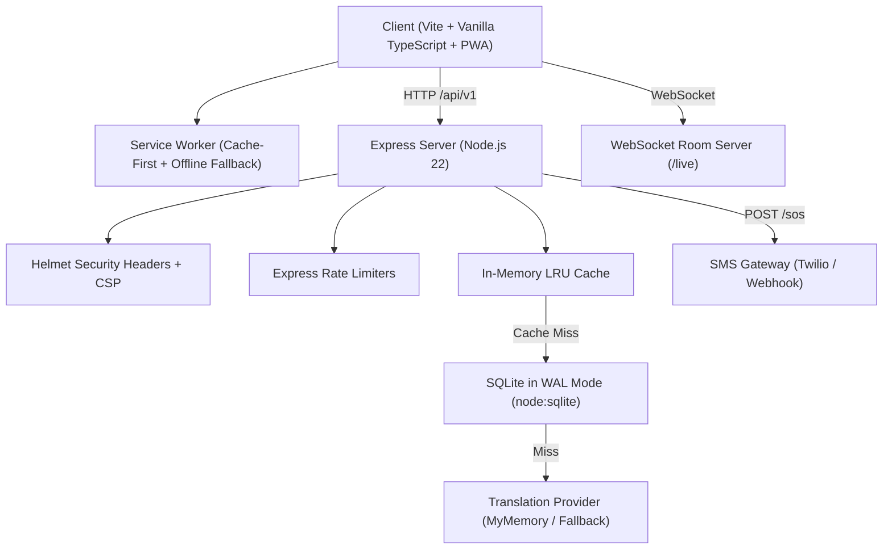

# ConnectPlus: Communication Without Barriers

> **An AI-powered, privacy-first, offline-ready accessibility web application designed for deaf, hard of hearing, mute, and speech-impaired individuals.**

---

## 🌟 Overview & Key Features

**ConnectPlus** bridges critical communication divides through an integrated, fast, full-stack accessibility suite:

1. **🗣️ Two-Way Communication**: Real-time Speech-to-Text with animated sound-wave visualizer and Text-to-Speech voice synthesis with word-by-word reading highlights, pitch, and speed controls.
2. **🧩 Interactive Communication Board**: Localized phrase tiles across all 5 languages, sentence builder bar with audio playback, favorites, search, custom phrase creation, and offline caching.
3. **💬 Live Captions & Shared Room**: Resizable captions (16px to 64px), speaker tags, transcript copy/download (.txt), and WebSocket room code live sharing across devices.
4. **🌐 Multilingual Localization & Translation**:
   - **5 Supported Indian Languages**: English (`en-IN`), Tamil (`ta-IN` / தமிழ்), Telugu (`te-IN` / తెలుగు), Malayalam (`ml-IN` / മലയാളം), and Kannada (`kn-IN` / ಕನ್ನಡ).
   - Instant UI switching without page reload across all buttons, labels, alerts, board tiles, errors, and default SOS messages.
   - All translations stored in `translations.js` with 100% key parity.
   - Documentation of nuances in `TRANSLATION_REVIEW.md`.
5. **🔔 Unified Sensory Alerts**: Consolidates edge-perimeter flashing, Web Audio alert chimes, haptic vibration feedback, and large high-contrast warning text banners with independent sound and vibration toggles.
6. **📳 Sudden Shake Detection (DeviceMotion API)**:
   - Detects rapid device shaking with adjustable sensitivity (Low, Medium, High).
   - Permission handling for iOS 13+ and modern browsers.
   - Cooldown timer (4s) to prevent stutter.
   - Test Shake Alert button.
   - **Safety Guarantee**: Shaking NEVER automatically triggers an SOS!
7. **🔊 Sudden Loud-Noise Detection (Web Audio API)**:
   - Monitors ambient sound for sudden spikes, sirens, or shouts.
   - Real-time animated sound-level meter (0 dB to 100 dB).
   - Adjustable sensitivity threshold presets.
   - **Local Privacy Guarantee**: Audio is analyzed strictly inside browser RAM; never recorded, saved, or uploaded.
   - Cooldown protection (4s) and Test Noise Alert button.
   - **Safety Guarantee**: Loud noise NEVER automatically triggers an SOS!
8. **🆘 Emergency SOS SMS Dispatch**:
   - Emergency contact management with phone validation (E.164, 8 to 15 digits) and primary contact selection.
   - Contacts stored securely with client-side obfuscation (no plain-text phone numbers in localStorage).
   - Confirmation dialog before sending SOS with recipient preview, sender name, GPS status, and message.
   - 3-second safety cancel countdown with audible beeps.
   - Backend dispatch via configured SMS Gateway (Twilio or custom webhook). Credentials are never exposed in frontend code.
   - Verified delivery: Success is shown ONLY if the gateway provider accepts the request.
   - Unconfigured Gateway Fallback: If no gateway is configured on the server, clearly states that no automated SMS was sent and provides a direct `sms:` deep-link (and WhatsApp fallback).
   - Duplicate dispatch prevention (20s cooldown lock) and rate limiting.
9. **🤖 AI Personal Assistant**:
   - Context-aware accessibility guide with intelligent FAQ keyword matching, prompt suggestion chips, microphone input, and optional Gemini/LLM fallback.

---

## 🏗️ Architecture & Technology Stack



- **Frontend**: Vite 6, Modern TypeScript, CSS Custom Properties (Design System tokens), Service Worker PWA (`sw.js`), Web App Manifest (`manifest.webmanifest`).
- **Backend**: Node.js 22, Express 5, TypeScript, Helmet (Content Security Policy, XSS, nosniff, frameguard), CORS, Express Rate Limit, SQLite database (`node:sqlite`) with WAL mode, LRU cache, and `ws` WebSocket server.
- **Accessibility & Design**: **WCAG 2.2 AA Compliant** with 44px+ touch targets, visible focus outlines, high-contrast theme, ARIA live announcements, screen reader support, keyboard shortcuts, and reduced-motion handling.

---

## 🎨 Brand & Color Palette

| Role | Color | Hex Code |
| :--- | :--- | :--- |
| **Primary Blue** | Deep Accessibility Blue | `#1E6FD9` |
| **Bright Blue** | Vibrant Accent | `#1E90FF` |
| **Teal** | Assistive Secondary | `#12A89D` |
| **Purple Accent** | AI & Visual Indicator | `#7C3AED` |
| **Dark Background** | Slate Dark Mode | `#0B1220` |
| **Light Background** | Soft High-Readability Light | `#F4F8FC` |
| **Emergency Red** | High-Visibility SOS | `#EF4444` |
| **Warning Amber** | Caution / Attention | `#F59E0B` |

---

## 🚀 Getting Started

### Prerequisites
- Node.js 20+ (Node.js 22 recommended)
- npm 10+

### Installation
1. Clone the repository:
   ```bash
   git clone https://github.com/kavanarangasamy07/ConnectPlus.git
   cd ConnectPlus
   ```
2. Install dependencies:
   ```bash
   npm install
   ```
3. Configure environment variables:
   ```bash
   cp .env.example .env
   ```
   *(Optional: fill in `TWILIO_ACCOUNT_SID`, `TWILIO_AUTH_TOKEN`, and `TWILIO_FROM_NUMBER` to enable automated SMS delivery, or leave unset to use the direct native `sms:` app link).*

### Running the Application
- **Run Server (Backend)**:
  ```bash
  npm run dev
  ```
- **Run Client (Vite Dev Server)**:
  ```bash
  npm run dev:client
  ```
- **Run Full Dev Suite (Server + Client concurrently)**:
  ```bash
  npm run dev:all
  ```
- **Build Production Bundle**:
  ```bash
  npm run build
  ```
- **Run Production Server**:
  ```bash
  npm start
  ```

---

## 🧪 Automated Testing

ConnectPlus includes a comprehensive Vitest test suite covering translations, validation, security, and API endpoints:

```bash
npm test
```

### Test Suites Included:
1. **`server/test/translations.test.ts`**:
   - 100% key parity across all 5 languages (`en`, `ta`, `te`, `ml`, `kn`).
   - Valid speech BCP-47 codes (`en-IN`, `ta-IN`, `te-IN`, `ml-IN`, `kn-IN`).
   - Validates localized communication board tiles in all languages.
   - Verifies no placeholder or empty strings.
2. **`server/test/validation.test.ts`**:
   - International phone sanitization & E.164 8-to-15 digit boundary tests.
   - Privacy masking (`+91 **** 3210`).
   - Contact storage encryption/obfuscation (ensuring plain-text numbers are never in localStorage).
   - Primary contact designation and selection.
   - Shake and noise detection thresholds and cooldown logic.
3. **`server/test/unit.test.ts`**:
   - LRU cache hit/miss and key generation.
   - Phone sanitizer.
   - FAQ matcher keyword scoring engine.
4. **`server/test/e2e.test.ts`**:
   - Static file serving of `/`.
   - Health endpoint (`/api/v1/health`).
   - Multilingual translation caching (`/api/v1/translate`).
   - AI assistant questions and suggestions (`/api/v1/assistant`).
   - Emergency SOS SMS dispatch & unconfigured gateway fallback (`/api/v1/sos`).
   - SOS Duplicate request prevention (409 Conflict).
   - SOS Invalid phone rejection (400 Bad Request).
   - Device custom phrases synchronization (`/api/v1/phrases`).
   - Live WebSocket room captions broadcasting (`/live`).

---

## ⌨️ Accessibility Keyboard Shortcuts

| Shortcut | Action |
| :--- | :--- |
| **Alt + M** | Toggle Speech-to-Text Microphone |
| **Alt + B** | Jump directly to Communication Board |
| **Alt + L** | Jump directly to Live Captions |
| **Alt + T** | Cycle Theme (Light → Dark → High Contrast) |
| **Alt + S** | Open Emergency SOS Confirmation Dialog |
| **?** (Shift + /) | Open Keyboard Shortcuts Help Dialog |
| **Esc** | Close any open modal dialog or cancel countdown |

---

## 🔒 Privacy and Security Policy
- **Client-Side Speech Processing**: Voice audio from the microphone is analyzed strictly in the browser memory using the Web Speech and Web Audio APIs. Audio is never recorded, saved, or uploaded to any server.
- **No Plain-Text Phone Numbers**: All emergency contact numbers and names stored in client storage are obfuscated/encrypted.
- **Secure SMS Dispatch**: Backend SMS gateway API keys remain strictly on the server (`.env`) and are never exposed to the frontend.
- **Safe Fallbacks**: If no SMS gateway is configured, no fake success is shown; a native `sms:` deep link is prefilled for direct dispatch.